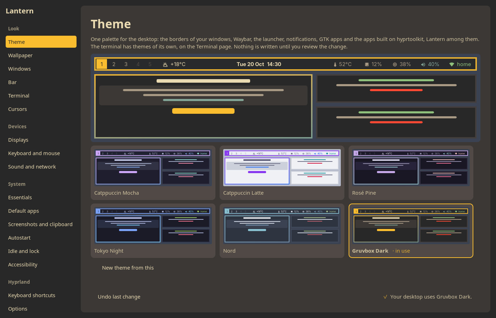
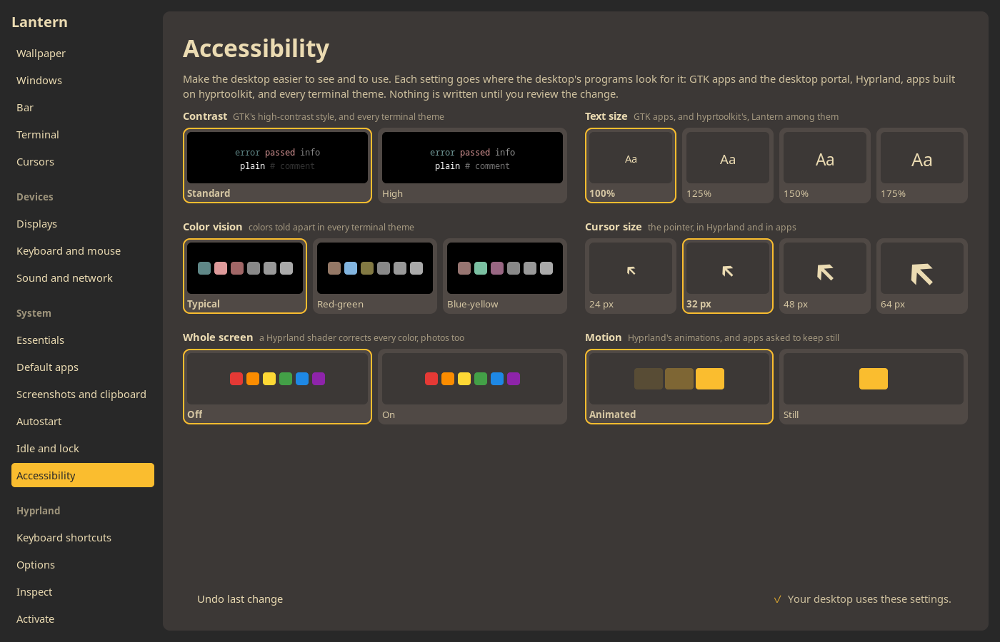
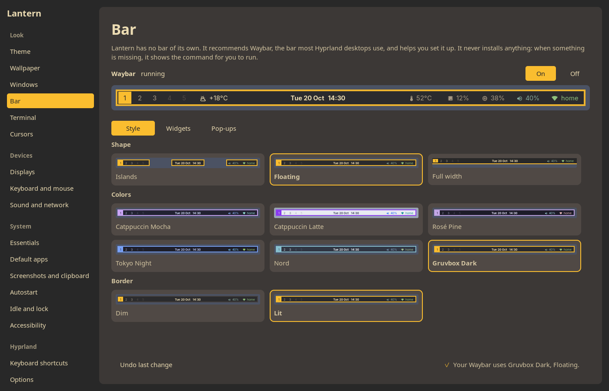
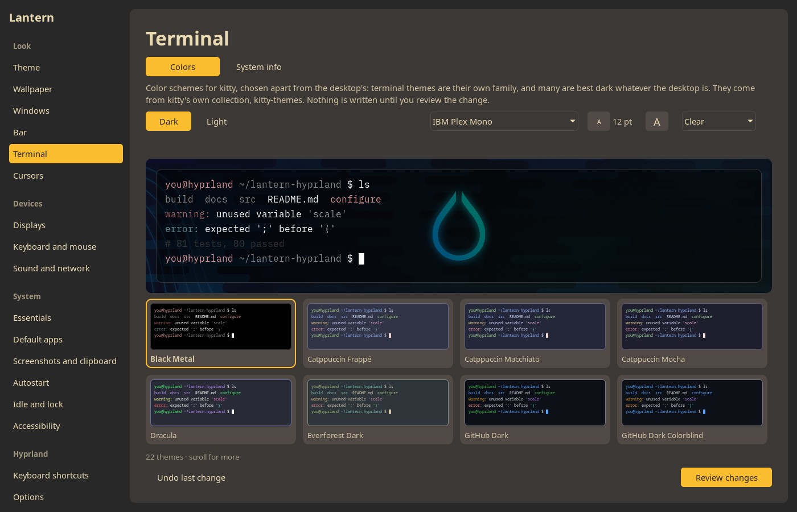
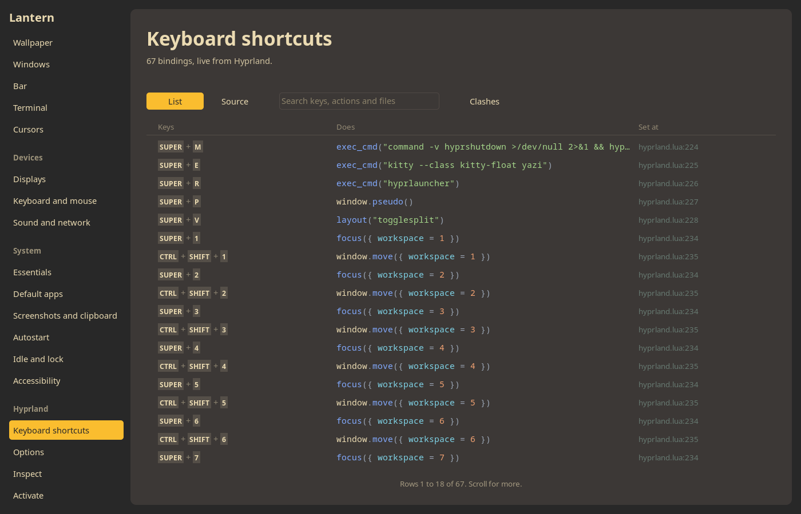
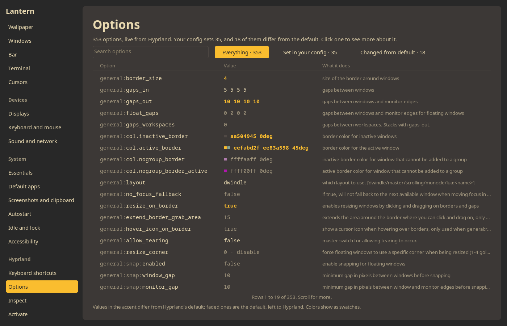

# Lantern for Hyprland

Lantern for Hyprland is a settings app for Hyprland that makes your desktop easier to
see, read and use, and then gets out of the way.

**Accessibility first.** Make text larger, raise the contrast, correct the colors for
color blindness across the whole desktop, calm the animations, and make the cursor easier
to find. Each one is set where your desktop already looks for it, so GTK apps, Hyprland
and the apps on top of it follow along.

**It never takes over.** Lantern installs nothing and runs nothing with `sudo`. It shows
every change as a diff before writing it, keeps a copy of what it replaced, and undoes it
in one click. What it writes is plain Hyprland, Waybar and GTK configuration, with no
markers and nothing of its own, so your desktop works the same if you stop using it.

**One look, everywhere.** Pick a theme and your window borders, Waybar, the launcher,
notifications and GTK apps all change together, and your terminal can match. Pick a
wallpaper and see it at once. Your bar follows your windows' corners, gaps and borders.

It also shows you what Hyprland is doing: every option with its documentation, every
keybinding and where it is set, a live map of your monitors and windows, an event log, and
a console that only reads. It is made for Hyprland alone, talking to Hyprland's own sockets
and reading and writing its Lua config.

> Lantern for Hyprland is an independent open-source project for configuring and managing
> Hyprland. It is not affiliated with or endorsed by the Hyprland project.

## Tested on

| Distribution | Hyprland | hyprtoolkit | Config | Graphics              | Lantern | Result |
| ------------ | -------- | ----------- | ------ | --------------------- | ------- | ------ |
| Arch Linux   | 0.56.2   | 0.6.0       | Lua    | AMD, amdgpu with Mesa | 0.1.0   | Works  |

Not tested yet: Fedora, openSUSE Tumbleweed, NixOS, Gentoo, Void Linux, and NVIDIA
graphics. If you run Lantern on any setup, please tell us how it went with a
[Tested on report](https://github.com/da0x/lantern-hyprland/issues/new?template=tested.yml),
even if everything worked. Each report adds a row here.













## Mission

Make Hyprland easier to understand and configure, in the least intrusive way possible.
Three promises carry everything else:

- **It never changes your system behind your back.** It installs nothing, runs nothing
  with `sudo`, and touches no file you have not approved. When an outside program would
  help, like a status bar, a dock or a notification daemon, it names an existing,
  well-known open-source one, tells you exactly what to install and why, and lets you
  install it yourself.
- **You make the decisions.** It shows what it finds, explains the options and what each
  would change, and may recommend one, but it never picks for you. A keybinding conflict
  is reported, not fixed; a suggestion stays a suggestion until you accept it.
- **You can leave at any time, and leave nothing behind.** Every change it makes to your
  config is plain Hyprland configuration, with no markers, no extra files and no `require`
  lines of its own, so your config keeps working exactly the same without it. Everything
  Lantern keeps for itself (its settings, and a backup of every file it changed)
  lives in one folder, `~/.config/lantern-hyprland/`. To stop using it, uninstall the
  package and delete that folder, or let Lantern delete it for you first.

If you ever wonder "what did this do to my system?", that is a bug.

## What it does

Each page does one thing. The sidebar groups them by what they are for.

**Look**

- **Theme:** one palette for the whole desktop: window borders, the bar, the app
  launcher, notifications, GTK apps and Lantern itself, shown on a picture of your
  desktop as it would look. Start a theme of your own from any of them, change its
  colors by their hex values, or pick them from the screen with hyprpicker, and keep
  it beside the built-in ones.
- **Wallpaper:** pick a picture from your Wallpapers folder or the system's, see it on
  the desktop at once, and keep it with hyprpaper or awww. A picture of yours you no
  longer want goes to the trash, where your file manager can bring it back.
- **Windows:** corners, gaps, border thickness, whether dragging a border resizes, and
  whether open and save dialogs float, with a preview of your screen. The bar's corners
  and gaps follow the windows'.
- **Bar:** a Waybar style that matches the theme, with a border like your windows', the
  widgets you choose on the left, center or right, such as the weather, media and
  processor, in the order you put them with the arrows, and a switch to start or stop it. Its Pop-ups tab turns on swayosd's volume
  and brightness pop-ups, drawn in the bar's colors.
- **Terminal:** a color scheme, font, text size and background opacity for kitty. Its
  System info tab sets up fastfetch's summary of the system: the logo, a color from the
  terminal's scheme, how much it shows, and whether each new terminal opens with it.
- **Cursors:** the mouse cursor's theme, each shown by its own cursors, and the
  distribution's with the command that installs one.

**Devices**

- **Displays:** each display's resolution, refresh rate, scale, rotation, variable
  refresh rate and place beside the others, and whether apps made for X11 stay sharp
  when a display is scaled. A change is put back after 15 seconds unless
  you keep it, so a display that goes dark fixes itself. Its Night light tab turns the
  screens warmer in the evening and back in the morning, through hyprsunset, with the
  warmth tried on the screens before you keep it.
- **Keyboard and mouse:** keyboard layouts and the keys that switch them, what Caps Lock
  does, how held keys repeat, Num Lock at start, the pointer's speed, acceleration,
  buttons and scroll direction, and the touchpad's tap to click, right click, pause while
  typing, scrolling and three-finger swipe between workspaces.
- **Sound, Bluetooth and network:** whether PipeWire, BlueZ and NetworkManager are running,
  the output and its volume, the connections in use, and buttons that open the volume
  control, Hyprland's sound center, the Bluetooth manager and the network connections,
  with the command that installs a missing one.

**System**

- **Essentials:** checks for what a Hyprland desktop needs beside Hyprland: the portals for
  screen sharing and file dialogs, a polkit agent for password prompts, a notification
  daemon, fonts for text and emoji, and Qt's Wayland support. Each one missing shows why it
  matters and the command that installs it; Lantern installs nothing. A polkit agent that
  is installed but not running can be started, now and with Hyprland.
- **Default apps:** the web browser, email, file manager, text editor, image viewer, PDF
  viewer, video and music players, among the apps installed that say they open them, with
  what the system picks while none is chosen; and the terminal that apps which run in one
  open in, through xdg-terminal-exec.
- **Screenshots and clipboard:** the keys that take screenshots with grim and slurp
  (Print for an area, Shift+Print for every screen, Ctrl+Print for the window in focus),
  the folder they go to, whether each is copied too and whether it opens in satty to draw
  on first; and a clipboard history kept by cliphist, with the key that opens it.
- **Autostart:** what starts when you log in: the programs your Hyprland config starts,
  and the autostart files other programs leave, each switched on or off, and a program
  added. Hyprland does not read autostart files by itself, so the page says what starts
  them, if anything, and offers dex.
- **Idle and lock:** dim, lock, turn the screens off and suspend after a time you choose,
  through hypridle; lock before sleeping; a lock screen in the theme's colors through
  hyprlock; and the power mode and brightness, when power-profiles-daemon and
  brightnessctl are installed.
- **Accessibility:** text size, contrast, color blindness, motion, and cursor size.

**Hyprland**

- **Keyboard shortcuts:** every binding, what it does, where in your config it is set,
  and which keys are bound more than once, with a search.
- **Options:** every Hyprland option with its value, default and description, and which
  ones your config sets or changes.
- **Inspect:** the running Hyprland, which it only reads, on three tabs. **Tree** is a
  map of your monitors and their windows, and the tree of monitors, workspaces and
  windows, kept current as things change. **Events** is what Hyprland reports as it
  happens, said in words. **Console** asks Hyprland what it knows, like `hyprctl`, but
  only with requests that read.
- **Activate:** applies Lantern's effects to the running desktop, in the areas you
  allowed; **Deactivate** puts everything back.

## Principles

- **You decide every change.** No package installs, no `sudo`, no replaced or moved
  files, no new autostart entries, nothing outside what you approved in a diff. Every
  change is recorded with a copy of the files it replaced, and can be undone.
- **Your config file is the source of truth.** Lantern reads and writes your own
  `hyprland.lua`. It keeps no database and no hidden copy, only its own window
  settings. Stop using it and you lose nothing.
- **Edits are lossless.** When it changes a value, it changes only that value. Your
  comments, formatting, `require` calls and anything it does not understand are left
  exactly as they were.
- **Safe before clever.** Activate never writes to your config: what it changes lives in
  the running session, only in areas you allowed, and one reload or one click on
  Deactivate undoes it. The pages that do write, like Theme, Windows and Bar, show every
  change as a diff first, back up what they replace, and put it back if Hyprland rejects
  it.

## What it reads and writes

This is everything Lantern touches. Nothing else is read, written or started.

### Reads

- **Hyprland:** your config folder, following links, and the running Hyprland's
  sockets. To learn which config Hyprland loaded, it reads Hyprland's lock file and
  command line. If they are installed, it also reads Hyprland's Lua type stubs in
  `/usr/share/hypr/stubs/`.
- **Bar page:** whether Waybar is installed, whether its icon font is, which config
  Waybar would read, and `/etc/os-release`, to show the install command for your
  distribution.
- **Wallpaper page:** the pictures in your Wallpapers folder (`~/Pictures/Wallpapers`),
  `~/.local/share/backgrounds`, `/usr/share/hypr` and `/usr/share/backgrounds`, and
  `hyprpaper.conf`, or which picture awww shows.
- **Terminal page and the Inspect page's Console:** kitty's `kitty.conf` and `current-theme.conf`. For the
  preview of a see-through terminal, the Terminal page asks awww which picture it shows.
- **Displays page:** each display Hyprland knows, with the modes it offers, from
  `hyprctl monitors all`.
- **Keyboard and mouse page:** the keyboard layouts xkeyboard-config lists in
  `/usr/share/X11/xkb/rules/evdev.lst`, and whether udev has found a touchpad, from
  `/run/udev/data`.
- **Sound, Bluetooth and network page:** `wpctl` for the output and its volume, `nmcli`
  for the connections, `systemctl is-active` for the Bluetooth and NetworkManager
  services, and `/sys/class/bluetooth` for the adapters. It writes nothing.
- **Essentials page:** the portals in `/usr/share/xdg-desktop-portal/portals`, the D-Bus
  services in `/usr/share/dbus-1/services`, the polkit agents and Qt plugins installed,
  your running programs, and fontconfig's fonts.
- **Screenshots and clipboard page:** the `hl.bind` lines in your Hyprland config, to find
  the Print key's folder and the history's key, and its start lines.
- **Autostart page:** the start lines in your Hyprland config, the `.desktop` files in
  `~/.config/autostart` and `/etc/xdg/autostart`, and `systemctl --user is-active` for
  whether systemd starts them.
- **Default apps page:** the `.desktop` files in your and the system's `applications`
  folders, every `mimeapps.list` in the order the XDG specification gives, each folder's
  `mimeinfo.cache`, and `~/.config/xdg-terminals.list`.
- **Cursors page:** the cursor themes in your icon folders and the system's, and their
  cursor files, to draw them.
- **Its own colors:** `~/.config/hypr/hyprtoolkit.conf`, like every hyprtoolkit app.

Reading your config never runs it. Lantern reads it in a sandbox of its own, where
commands, file writes and startup programs are noted but never carried out.

### Writes

Only after you review the change line by line. When your config is a link, Lantern
writes the file it points to, and the review says which one.

- **Theme:** the window border colors in your Hyprland config, Waybar's files, the
  colors in `hyprtoolkit.conf`, wofi's `style.css` and dunst's `dunstrc` if you have
  them, a `gtk.css` for GTK 3 and one for GTK 4 that give GTK apps the palette, GTK 3's
  dark or light preference in `settings.ini`, and GTK's dark or light preference and
  accent color in GNOME's settings.
- **Wallpaper:** `hyprpaper.conf`, and the lines in your Hyprland config that start the
  wallpaper program at login and turn off Hyprland's own wallpaper. A picture you add
  is copied into your wallpapers folder under a new random name.
- **Windows:** the corners, gaps, border size and resizing in your Hyprland config, a
  window rule named `float-file-pickers` for the portal's open and save dialogs, and
  Waybar's files, so the bar keeps matching.
- **Displays:** the `hl.monitor` call for each display you change in your Hyprland
  config, only the values that changed. A display your config sets only through a rule
  for every display gets a call of its own, by its make, model and serial number, so it
  keeps its settings on another port. Keeping X11 apps sharp sets XWayland's
  `force_zero_scaling` and, at a scale of 2 or more, `GDK_SCALE`.
- **Keyboard and mouse:** the layouts, variants, xkb options, key repeat, Num Lock,
  pointer speed, acceleration, left-handed buttons, scroll direction and touchpad settings
  in your Hyprland config's `input` table, and the `hl.gesture` call for a three-finger
  swipe between workspaces. xkb options Lantern has no choice for are kept as they are.
- **Bar:** Waybar's `config.jsonc` and `style.css`, and rules in your Hyprland config that
  float the volume control and network settings the bar opens. The weather widget, when
  you turn it on, has Waybar ask the website wttr.in for the temperature every half hour,
  which lets that site see roughly where you are. The pop-ups, when you turn them on: a
  start line for `swayosd-server` and the volume, mute and brightness keys in your
  Hyprland config, and `~/.config/swayosd/style.css`, which a new bar style writes again
  in its colors. Turned off, the keys go back to `wpctl` and `brightnessctl`.
- **Terminal:** kitty's `current-theme.conf`, and the font, text size, opacity and theme
  lines in `kitty.conf`.
- **Cursors:** `XCURSOR_THEME` in your Hyprland config, `~/.icons/default/index.theme`,
  which X11 apps read, and GTK's cursor theme in GNOME's settings. Hyprland shows the new
  cursor at once.
- **Accessibility:** animations, the cursor size and the color-correction shader in your
  Hyprland config, the shader itself in `~/.config/hypr/shaders/`, the text sizes in
  `hyprtoolkit.conf`, and the desktop's contrast, motion, text size and cursor size
  settings.
- **Night light:** the profiles in `~/.config/hypr/hyprsunset.conf`, the rest kept, and a
  line in your Hyprland config's start for hyprsunset, which turning it off takes out
  again. Trying a warmth uses `hyprctl hyprsunset`, which changes nothing on disk.
- **Idle and lock:** `~/.config/hypr/hypridle.conf`, where the listeners Lantern knows
  are replaced and the rest kept, a line in your Hyprland config's start for hypridle, and
  `~/.config/hypr/hyprlock.conf` when you choose the theme's lock screen. It starts
  hypridle again after a change so that it reads it. The power mode and brightness are
  set at once with `powerprofilesctl` and `brightnessctl`, not written anywhere.
- **Essentials:** only when you start a polkit agent from it: a line in your Hyprland
  config's start that runs the agent after you log in.
- **Autostart:** the start lines in your Hyprland config, where a line switched off is
  commented out, and, for an autostart file switched off or on, its copy in
  `~/.config/autostart` with `Hidden` set. Nothing is started or stopped until your next
  login.
- **Default apps:** the `[Default Applications]` lines for each kind's file types in
  `~/.config/mimeapps.list`, or in `hyprland-mimeapps.list` when you have one, and the
  terminal at the top of `~/.config/xdg-terminals.list`.
- **System info:** fastfetch's `~/.config/fastfetch/config.jsonc`, written whole, and,
  for new terminals to open with it, a line at the end of `~/.bashrc`.
- **Screenshots and clipboard:** the three screenshot keys, as `hl.bind` lines, in your
  Hyprland config; and for the history, a start line for `wl-paste --watch cliphist
  store` and the key that opens it, which takes the place of a key bound to something
  else if you choose one.

Desktop settings are changed through `gsettings`, and their old values are kept so Undo
can restore them. After any change to your Hyprland config, Lantern asks Hyprland whether
it found errors, and puts the files back if it did.

### Its own folder

Everything Lantern keeps for itself is in `~/.config/lantern-hyprland/`, and a menu item
deletes it for you:

- `settings.json`: the window size, the last page, which areas you allowed, and
  checklists you dismissed.
- `effects.lua`: the effects Activate applies, as plain Hyprland Lua you can copy into
  your own config.
- `activation.json`: what is active right now, so Deactivate works even after Lantern
  was closed.
- `backups/`: a record of each change, with copies of the files it replaced, for Undo.
- `themes/`: the themes you made, one file each, a line for each color, which you can
  share or edit by hand.

There are no caches and no exports. Copying goes to the clipboard.

### Starts and stops

- **Waybar, hyprpaper and awww,** only when you press their On or Off switch. If one is
  running when Lantern writes its files, Lantern restarts it so it reads them.
- **A wallpaper preview.** Picking a picture shows it straight away, without writing
  anything, and leaving the page puts back the one you applied. Applying makes the
  chosen program your only wallpaper program, at login too.
- **Helpers you already have:** `wl-copy` for the Copy buttons, and your desktop's own
  file chooser for adding pictures.

### Changes while active

Only in the areas you allowed on the Activate page: the running Hyprland's options, rules
and keybindings, which a reload undoes, the programs you allowed it to start, and your
desktop theme settings.

## Status

0.1, the first release. Every page above works.

It needs:

- **Hyprland 0.56.** It is tested with 0.56.2. Hyprland changes its config and its IPC
  often, so a newer release may need a newer Lantern.
- **A Lua config** (`hyprland.lua`). Lantern reads the older `hyprland.conf` too, but
  changes only a Lua config so far.

Research is in [`docs/research.md`](docs/research.md), the design in
[`docs/architecture.md`](docs/architecture.md), and the gaps in Hyprland's IPC in
[`docs/upstream.md`](docs/upstream.md). Work is planned in
[GitHub issues](https://github.com/da0x/lantern-hyprland/issues).

## Roadmap

Next, in no fixed order: Qt apps in the theme, changing any option from the Options page
and saving it to your config, keeping an activation across restarts (opt-in), dragging
displays into place, keybinding and window-rule editors, an animation and bezier editor,
and writing the older `hyprland.conf` format.

## Installing

On Arch Linux, build the package from the recipe in `packaging/arch`:

```
git clone https://github.com/da0x/lantern-hyprland
cd lantern-hyprland/packaging/arch
makepkg -si
```

It builds the release from its tagged source, checked against a pinned checksum, and
installs it with pacman, so `sudo pacman -R lantern-hyprland` removes it again. Lantern
will be on the AUR once the AUR takes new accounts again. On other distributions, build it
from source as below.

## Building

Lantern is written in C++26 on [hyprtoolkit](https://github.com/hyprwm/hyprtoolkit),
Hyprland's own Wayland-native toolkit, and builds with CMake. On Arch Linux, the packages it
needs are:

```
sudo pacman -S --needed base-devel cmake ninja hyprtoolkit lua tree-sitter tree-sitter-lua nlohmann-json fontconfig systemd-libs gtest
```

Then, from the repository:

```
make                  # build into build/release
make test             # run the tests
sudo make install     # install under /usr/local
sudo make uninstall   # remove what make install put there
```

`make install PREFIX=~/.local` installs for your user only, without `sudo`.

With hyprtoolkit 0.6.0, the current release, Lantern may crash now and then, and after you
make the text smaller, the sidebar can keep its old width until the window is resized. To
stay clear of the crash, the theme and wallpaper cards move a row at a time with the mouse
wheel instead of scrolling smoothly. Fixes have been submitted to hyprtoolkit and will be
in a future release. To build against a hyprtoolkit that already has them, install it
somewhere of its own and point Lantern at it: `make HYPRTOOLKIT_PREFIX=/where/it/is/installed`.

`make install` builds nothing itself, so run `make` as yourself first. Packagers can use CMake directly:
the build takes the usual `CMAKE_BUILD_TYPE`, `CMAKE_INSTALL_PREFIX` and `DESTDIR`.

## Contributing

Open an issue: a bug, an idea, or a report of what you tested on. I usually make the
change myself, so you do not need to write code to help. Pull requests are welcome only
for small changes to an issue we have agreed on; large ones will be closed. See
[`CONTRIBUTING.md`](CONTRIBUTING.md) for why, and how.

## Acknowledgements

Lantern is written with AI coding agents, under my direction and review.

Lantern learned from [Noctalia](https://github.com/noctalia-dev/noctalia), an
MIT-licensed Wayland shell by noctalia-dev and contributors: in particular its direct use
of Hyprland's sockets, and its rule of never managing the user's compositor config. No
Noctalia code is included.

The Terminal page's themes are kitty's own color schemes from
[kitty-themes](https://github.com/kovidgoyal/kitty-themes) (GPL-3.0), bundled unchanged in
`src/desktop/terminal-themes/`, each with its author and, for most, its MIT license in its
header.

## License

GPL-3.0-or-later. See [`LICENSE`](LICENSE).

`SPDX-License-Identifier: GPL-3.0-or-later`
